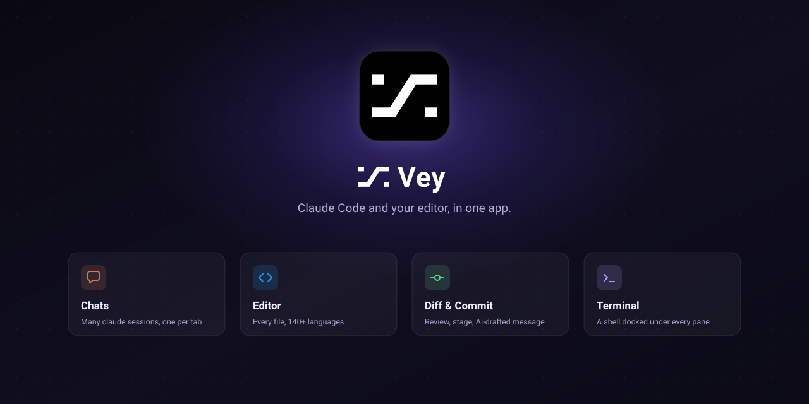

<div align="center">



# Vey

**The agent-first desktop studio for Claude Code.**

[](https://github.com/veystudioapp/vey/releases/latest)
[](https://github.com/veystudioapp/vey/releases)
[](LICENSE)

</div>

---

Give every task its own Claude Code agent. They work side by side — in your files, a terminal and a real browser — and every change waits in one diff for you to review, commit and push. All in one window, over the folders you already work in.

https://github.com/user-attachments/assets/88739502-55f2-4c27-ad84-6b630d66d701

## How it works

**Every task gets its own agent.** Start one, start another, keep going. The chats column sorts them into _Needs you_, _Running_ and _Recent_, so you only look where you're needed.

- A notification when an agent stops to ask
- Send more while it works — the message waits its turn
- Pop a chat out into a window of its own
- A worktree per task, so branches never collide

**It opens the app and checks its own work.** Every chat has a tabbed browser beside it. Claude navigates, reads the page, clicks, types and takes screenshots — and you watch it happen.

- Look-only in _Plan_ and _Read only_
- Import cookies to reach pages you're signed in to
- Draw on a page and hand the picture to the chat

**Read the diff. Draft the message. Push.** Everything the agents changed lands in the Git tab. Read it, have Claude draft the commit message from what's staged, then commit and push without leaving the window.

- Stage, unstage or discard file by file
- Push runs in the background
- Who last changed a line, right in the editor

### And the rest

- **Undo by editing** — edit an earlier message, and the files Claude changed after it go back too.
- **You decide what it may do** — five modes, from _Plan_ (only reads and plans) to _Full access_. Change it any time, even mid-chat.
- **Editor and terminal** — open any file, see who last changed each line, and run commands right under the chat.
- **Search everything** — any text across all your files and every past conversation.
- **Your MCP servers, per chat** — every server your `claude` already has, with any tool switched off for one chat alone.

## Bring your own Claude

Vey runs the `claude` CLI already on your machine, signed in as you. It sells no tokens and caps no quota: requests go from your computer to Anthropic, or to the endpoint you pick.

| Account           | Plan                  | Sign in with                   |
| ----------------- | --------------------- | ------------------------------ |
| Claude Pro · Max  | Subscription          | `claude auth login --claudeai` |
| Anthropic Console | API billing           | `claude auth login --console`  |
| Claude for Work   | Team · Enterprise SSO | `claude auth login --sso`      |
| Z.ai · GLM        | Custom API            | `api.z.ai/api/anthropic`       |
| Kimi              | Custom API            | `api.moonshot.ai/anthropic`    |
| DeepSeek          | Custom API            | `api.deepseek.com/anthropic`   |

Any other Anthropic-compatible endpoint works the same way — OpenRouter, or your company's gateway. Accounts are added from the **Accounts** list at the foot of the chats column.

## Download

Every build is on the [latest release][latest]:

| OS      | Architecture  | File                            |
| ------- | ------------- | ------------------------------- |
| macOS   | Apple Silicon | `Vey-<version>-arm64.dmg`       |
| macOS   | Intel         | `Vey-<version>-x64.dmg`         |
| Windows | x64           | `Vey-<version>-x64.exe`         |
| Linux   | x64           | `Vey-<version>-x86_64.AppImage` |

Every build is **unsigned**, so each OS objects in its own way. That is what the last line of each section below is about.

### macOS

macOS 12 (Monterey) or newer, Apple Silicon or Intel. Open the `.dmg` and drag Vey into Applications, then run this once:

```bash
xattr -dr com.apple.quarantine "/Applications/Vey.app"
```

Vey isn't signed with an Apple certificate yet, so macOS quarantines a `.dmg` downloaded in a browser and Gatekeeper then calls the app _"damaged"_ — which only ever means unsigned. The command lifts that quarantine.

### Windows

x64. The `.exe` is an NSIS installer. SmartScreen stops it: _More info_ → _Run anyway_.

### Linux

x64. The AppImage is the whole install.

```bash
chmod +x Vey-*.AppImage
./Vey-*.AppImage
```

It needs FUSE (`sudo apt install libfuse2` on Debian and Ubuntu), or `--appimage-extract-and-run` without it.

## Your first chat

1. **Open a project** — click **+** beside Projects and pick a folder already on your computer. Vey works on it where it is.
2. **Check Claude Code** — the `claude` you already use is listed under **Accounts** at the bottom of the chats column, as _This account_.
3. **Hand off a task** — press **+ Chat** and describe the work. What it changes shows up in the Git tab, ready to review.

## Updating

The app checks this repository for a newer release and offers to install it — on Windows by running the new installer silently once the app has quit. Installing a newer build from [Releases][latest] by hand does the same.

## Requirements

The [`claude`](https://docs.anthropic.com/en/docs/claude-code) CLI — Vey runs your own, with your login, your settings and your MCP servers. Vey is developed and used day to day on macOS; the Linux and Windows builds come out of the same workflow, but assume rough edges.

Where your requests go: straight from the app to Anthropic on your own account, or to the endpoint you set up. Vey's own server only receives anonymous usage counts — how long the app is in use, its version and OS — never anything about what you work on.

## Building from source

```bash
bun install
bun run dev    # run it
make app       # an unpacked .app
```

[`CONTRIBUTING.md`](CONTRIBUTING.md) has the rest. Chat export and the usage dashboard are [plugins](plugins/) — the same way you can extend it.

## Feedback

Bugs and requests go to [Issues](https://github.com/veystudioapp/vey/issues). Security reports should not: see [`SECURITY.md`](SECURITY.md). Everyone taking part is held to the [Code of Conduct](CODE_OF_CONDUCT.md).

To talk with other users, join the community:

- [Facebook](https://www.facebook.com/groups/2095997741054237)

## License

[MIT](LICENSE).

[latest]: https://github.com/veystudioapp/vey/releases/latest
